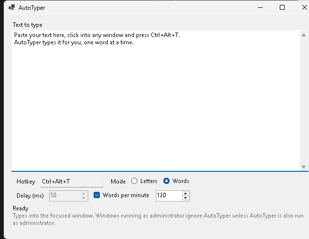

# AutoTyper

Paste text into AutoTyper, click into any window, press a hotkey, and AutoTyper types the text
there as real keystrokes. Because it types instead of pasting, it works in fields that block
pasting.



The screenshot shows the Windows version. There is also a version for Macs: see
[AutoTyper on macOS](#autotyper-on-macos).

## Download

Get the latest `AutoTyper-<version>-win-x64.zip` from the [Releases page](../../releases/latest),
unzip it, and double-click `AutoTyper.exe`. There is nothing to install and you do not need .NET.

Windows may show "Windows protected your PC" the first time, because the program is not signed.
Click **More info**, then **Run anyway**.

## How to use it

1. Paste your text into the big box.
2. Choose how it types:
   - **Letters** types one character at a time.
   - **Words** types one word at a time.
3. Set the pace:
   - **Delay (ms)** is the wait after each letter or word, from 0 to 60,000 ms.
   - In Words mode you can tick **Words per minute** instead and set a speed from 1 to 1,000.
     The speed is a target: the time spent typing a word counts toward its share of the minute.
4. Click into the window you want to type into and press **Ctrl+Alt+T**. Press it again to stop.

To change the hotkey, click the Hotkey box and press the combination you want. The hotkey, mode,
delay and speed are remembered. The text you paste is never saved.

Emoji, accented letters and line breaks all work.

## Good to know

- Windows does not let a program type into a window that is running as administrator, unless that
  program is also run as administrator.
- Windows 11 Notepad has its own spell check and autocorrect, which can rewrite words as they are
  typed, especially misspelled ones. Turn them off in Notepad's settings if you need exact text
  there. Most other programs are not affected.
- How fast text can be typed depends on your PC. A delay of 0 means "as fast as Windows allows",
  which on some machines is only a few dozen characters a second.
- AutoTyper only types into the window that has focus when you press the hotkey. It will not type
  into its own window.

Tested on Windows 11 (64-bit).

## AutoTyper on macOS

**Status:** the macOS version is new in 1.1.0 and has had little testing on real Macs. Test reports
are welcome: [docs/macos-testing.md](docs/macos-testing.md) lists what to try and what to include in
a report.

It needs **macOS 15 (Sequoia) or newer**. The Apple Silicon build is the one being tested; the
Intel (x64) build has not been tested.

### Download and open it

1. Get the latest `AutoTyper-<version>-macos-arm64.zip` from the
   [Releases page](../../releases/latest) (`-macos-x64.zip` is for Intel Macs; if you are not sure
   which you have, the Apple menu > About This Mac shows a chip or processor) and unzip it. Move
   `AutoTyper.app` wherever you like, for example into Applications.
2. Double-click `AutoTyper.app`. macOS refuses to open it, because the app is not signed by a
   registered Apple developer. Dismiss the warning (**Done**, not "Move to Trash").
3. Open **System Settings > Privacy & Security** and scroll down to the **Security** section.
   Next to the message about AutoTyper, click **Open Anyway** and enter your password.
4. Double-click `AutoTyper.app` again and click **Open**.

You only have to do this once for each version. The exact wording of these dialogs may differ between
macOS versions.

If you prefer Terminal, you can skip steps 2 and 3: run this first (type it, drag `AutoTyper.app` onto
the Terminal window to fill in the path, press Return), then open the app as usual:

```sh
xattr -dr com.apple.quarantine /path/to/AutoTyper.app
```

### Allow it to type

macOS only lets an app type for you once you allow it. Open **System Settings > Privacy & Security >
Accessibility** and switch **AutoTyper** on (if it is not in the list, click **+** and choose
`AutoTyper.app`). If AutoTyper's window shows a button **Open Accessibility settings**, it opens
that page for you. If it still says it needs permission afterwards, quit AutoTyper and open it again.

Each build of AutoTyper has its own ad-hoc signature, so after you install a newer version macOS may
no longer trust it. If AutoTyper stops typing after an update, switch it off and on again in the
Accessibility list, or remove it with **-** and add it again.

### How to use it

Use it as described under [How to use it](#how-to-use-it), but the default hotkey is
**Control+Option+T**. To change it, click the Hotkey box and press the combination you want; it needs
Control, Option, Shift or Command (or can be an F-key on its own). The hotkey, mode, delay and speed are
remembered in `~/Library/Application Support/AutoTyper/settings.json`. The text you paste is never
saved.

### Good to know

- On macOS 15.0 and 15.1, shortcuts whose only modifier is Option (or Option+Shift) have been
  reported to be accepted but never fire. The default, Control+Option+T, is not affected. When you
  pick your own hotkey, add Control or Command as well.
- TextEdit's **Correct spelling automatically** and smart quotes can rewrite the text as it is typed,
  much as Windows 11 Notepad does on Windows. Turn them off (Edit > Spelling and Grammar, and
  Edit > Substitutions) if you need exact text there. Most other programs are not affected.
- AutoTyper only types into the window that has focus when you press the hotkey. It will not type
  into its own window.

## Build it yourself

You need the [.NET 10 SDK](https://dotnet.microsoft.com/download) on Windows.

```powershell
dotnet build
dotnet test                       # the hotkey tests need a normal desktop session
powershell -File scripts\package.ps1   # builds release\AutoTyper-<version>-win-x64.zip
```

`scripts\e2e.ps1 -ExePath <AutoTyper.exe>` runs the real app against a scratch text box and checks
what arrives. It takes over the keyboard while it runs, so leave the PC alone until it finishes, and
close any copy of AutoTyper first.

The Mac app is built from `AutoTyper.Mac`. To package it you need a Mac with the .NET 10 SDK, because
the script uses `codesign` and `ditto`:

```sh
bash scripts/package-mac.sh arm64   # builds release/AutoTyper-<version>-macos-arm64.zip
bash scripts/package-mac.sh x64     # the same for Intel: release/AutoTyper-<version>-macos-x64.zip
```

## Making a release

1. Change `<Version>` in `Directory.Build.props` and commit.
2. Tag the commit with the same number and push the tag:

   ```powershell
   git tag v1.0.1
   git push origin v1.0.1
   ```

GitHub Actions then runs the tests, builds the zip and attaches it to a new release.

## License

MIT. See [LICENSE](LICENSE).
